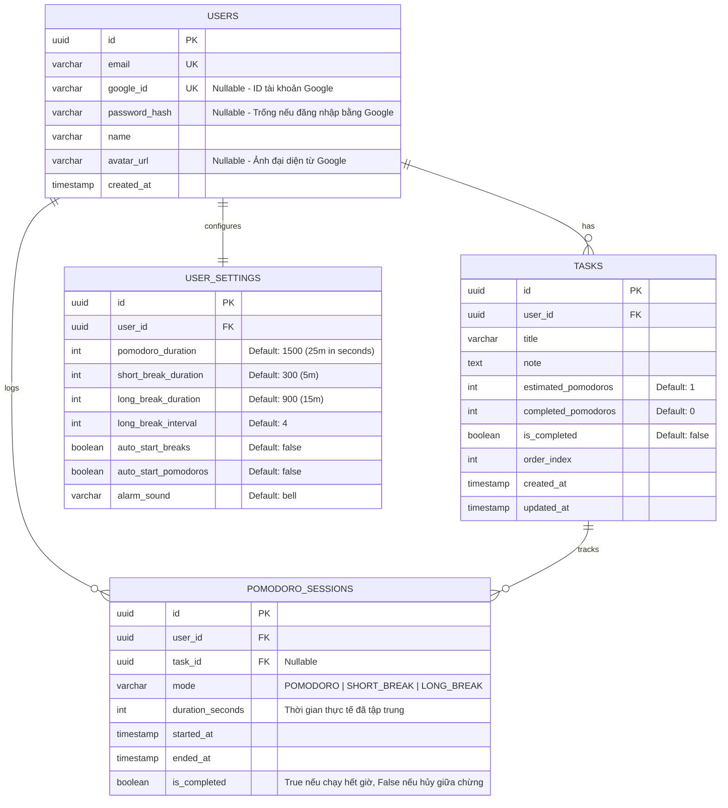

# TÀI LIỆU YÊU CẦU HỆ THỐNG: POMODORO PWA

## 1. Tổng quan Dự án (Project Overview)
* **Mục tiêu:** Xây dựng ứng dụng quản lý thời gian theo phương pháp Pomodoro kết hợp quản lý công việc (Task Management) và thống kê hiệu suất.
* **Triết lý sử dụng (Local-First / Optional Auth):** Người dùng **không bắt buộc phải có tài khoản** để sử dụng ứng dụng. Toàn bộ tính năng cốt lõi (đếm giờ, tạo task, cài đặt, xem thống kê cơ bản) đều hoạt động 100% trực tiếp trên thiết bị (lưu trữ tại `localStorage` / `IndexedDB`). Việc đăng ký/đăng nhập chỉ dành cho những người dùng có nhu cầu **lưu trữ tiến trình lên đám mây (Cloud Backup)** và **đồng bộ dữ liệu đa thiết bị** (ví dụ: dùng chung giữa PC và điện thoại).
* **Định hướng đa nền tảng:** Thiết kế theo hướng **Mobile-First Responsive Web**, tích hợp **PWA (Progressive Web App)** để người dùng trên iOS/Android có thể "Add to Home Screen" (cài đặt như app native), dùng toàn màn hình (standalone), nhận thông báo đẩy và hoạt động ngay cả khi mất mạng (Offline-first).

---

## 2. Tech Stack

### Frontend (Client-side & PWA)
* **Core:** React + TypeScript, khởi tạo bằng **Vite** (tối ưu tốc độ build).
* **PWA Engine:** `vite-plugin-pwa` (Workbox) để tự động sinh Service Worker và `manifest.json`.
* **Styling & UI:** TailwindCSS + Shadcn/UI (hoặc Radix UI) giúp giao diện đẹp, nhẹ và dễ làm responsive cho mobile.
* **State Management & Local Storage:** `Zustand` (kết hợp middleware `persist` lưu vào `localStorage`/`IndexedDB` để đảm bảo người dùng không cần tài khoản vẫn lưu được toàn bộ tiến trình trên máy).
* **Data Fetching & Sync:** `@tanstack/react-query` (hỗ trợ cache và đồng bộ dữ liệu lên server cho người dùng có đăng nhập).
* **Timer Accuracy:** Sử dụng **Web Workers** để đếm giờ (tránh việc trình duyệt mobile tự động làm chậm/dừng `setInterval` khi người dùng tắt màn hình hoặc chuyển sang tab khác).

### Backend (Server-side)
* **Core:** Node.js + Express.js + TypeScript.
* **ORM:** **Prisma** (type-safe tuyệt đối với TypeScript, trực quan và quản lý migration dễ dàng với PostgreSQL).
* **Authentication (Tùy chọn cho người dùng muốn lưu tiến trình):** Ưu tiên **Google OAuth2 (Đăng nhập 1 chạm với Google Identity Services)** kết hợp JWT (hoặc Email/Password truyền thống). Chỉ kích hoạt khi người dùng chủ động đăng nhập để đồng bộ dữ liệu; không chặn quyền sử dụng app của người dùng ẩn danh (Guest).
* **Validation:** `Zod` (dùng chung schema kiểm tra dữ liệu cho cả Frontend và Backend).
* **Web Push:** Thư viện `web-push` (VAPID keys) để gửi thông báo khi hết giờ nếu app đang chạy ngầm trên điện thoại.

### Database
* **Hệ quản trị:** PostgreSQL (Lưu trữ dữ liệu cho nhóm người dùng có tài khoản).

---

## 3. Yêu cầu Chức năng (Functional Requirements)

### 3.1. Bộ đếm Pomodoro (Core Timer)
1. **3 Chế độ chuẩn:**
   * **Pomodoro (Tập trung):** Mặc định 25 phút.
   * **Short Break (Nghỉ ngắn):** Mặc định 5 phút.
   * **Long Break (Nghỉ dài):** Mặc định 15 phút (tự động chuyển sau mỗi 4 phiên Pomodoro).
2. **Điều khiển:** Start (Bắt đầu), Pause (Tạm dừng), Reset (Đặt lại), Skip (Bỏ qua phiên hiện tại).
3. **Cơ chế tính giờ chính xác:** Lưu mốc `startTime` (timestamp) kết hợp Web Worker thay vì chỉ trừ lùi từng giây để khi người dùng khóa màn hình điện thoại rồi mở lại, thời gian vẫn nhảy đúng thực tế.
4. **Âm thanh & Thông báo:** Phát âm thanh chuông báo (Ticking sound / Alarm sound) và gửi Notification khi kết thúc phiên.

### 3.2. Quản lý Công việc (Task Management)
1. **CRUD Task:** Tạo, xem, sửa, xóa công việc cần làm trong ngày (lưu ngay tại Local, nếu đã đăng nhập thì đồng bộ ngầm lên Server).
2. **Ước lượng Pomodoro:** Mỗi task có số Pomodoro dự kiến (`estimated_pomodoros`) và số Pomodoro thực tế đã hoàn thành (`completed_pomodoros`).
3. **Active Task:** Chọn 1 task đang làm để gắn trực tiếp vào phiên Pomodoro đang chạy. Khi phiên Pomodoro kết thúc, tự động `+1` vào `completed_pomodoros` của task đó.
4. **Phân loại trạng thái:** `Todo`, `In Progress`, `Completed`.

### 3.3. Cá nhân hóa & Cài đặt (Settings)
1. Tùy chỉnh thời lượng cho từng chế độ (Pomodoro / Short Break / Long Break).
2. Tùy chỉnh số phiên Pomodoro trước khi vào Long Break.
3. Bật/tắt chế độ tự động chạy phiên tiếp theo (`Auto-start Breaks` / `Auto-start Pomodoros`).
4. Chọn âm báo và chỉnh âm lượng; bật/tắt Dark Mode.

### 3.4. Chế độ Không Tài khoản (Local Mode) & Đồng bộ Tài khoản (Cloud Sync)
1. **Mặc định Không cần Tài khoản (Local Mode):**
   * Người dùng vào web/app là sử dụng được ngay lập tức tất cả tính năng.
   * Toàn bộ Tasks, Settings và Lịch sử phiên Pomodoro được lưu cục bộ trên trình duyệt (`localStorage` / `IndexedDB`).
2. **Đăng ký / Đăng nhập bằng Google OAuth2 (Tùy chọn):**
   * Dành cho người dùng có nhu cầu lưu lại tiến trình lâu dài (tránh mất dữ liệu khi xóa cache trình duyệt) hoặc muốn đồng bộ giữa máy tính và điện thoại.
   * Cung cấp nút **"Tiếp tục với Google" (1-Click Google Sign-In)** làm phương thức chính để người dùng không phải nhớ mật khẩu hay điền form phức tạp (vẫn hỗ trợ Email/Mật khẩu dự phòng).
   * Khi người dùng đăng nhập lần đầu trên thiết bị, hệ thống tự động **gộp (merge/sync)** dữ liệu đã làm ở chế độ Local trước đó lên PostgreSQL để không bị mất tiến trình cũ.

### 3.5. Thống kê (Analytics / Reports)
1. Tổng số giờ tập trung theo Ngày / Tuần / Tháng (hiển thị từ dữ liệu Local hoặc dữ liệu Cloud nếu đã đăng nhập).
2. Chuỗi ngày tập trung liên tiếp (Streak).
3. Biểu đồ phân bổ thời gian theo Task.

---

## 4. Yêu cầu Đặc thù cho PWA & Mobile (Non-Functional & PWA Requirements)

Để trải nghiệm trên điện thoại giống Native App nhất, cần đáp ứng các yêu cầu sau:
1. **Web App Manifest (`manifest.json`):**
   * Cấu hình `"display": "standalone"` để ẩn thanh địa chỉ trình duyệt khi mở từ màn hình chính.
   * Đầy đủ bộ icon chuẩn cho Android (Maskable icons) và iOS (`apple-touch-icon`).
2. **Cơ chế Offline-First & Background Sync:**
   * **Service Worker** cache toàn bộ static assets (HTML, CSS, JS, file âm thanh `.mp3`).
   * Người dùng không đăng nhập luôn dùng được 100% offline.
   * Đối với người dùng đã đăng nhập: Nếu mất mạng khi đang chạy Pomodoro, phiên làm việc được lưu tạm vào `IndexedDB` và tự động gọi API đồng bộ lên Backend ngay khi có sự kiện `window.ononline`.
3. **Xử lý giới hạn của Mobile OS:**
   * **Screen Wake Lock API (`navigator.wakeLock`):** Tùy chọn giữ màn hình điện thoại luôn sáng khi đang đếm giờ.
   * **Media Session API / Web Push:** Hiển thị thông báo khi hết giờ kể cả khi người dùng thoát ra màn hình chính.
4. **UI/UX cho Mobile:**
   * Sử dụng **Bottom Navigation Bar** trên màn hình nhỏ (dưới 768px) để dễ bấm bằng một tay.
   * Chặn hành vi pull-to-refresh vô tình (`overscroll-behavior-y: contain`) và tắt highlight xanh khi chạm (`-webkit-tap-highlight-color: transparent`).

---

## 5. Thiết kế Cơ sở dữ liệu (PostgreSQL Schema với Prisma)

*(Lưu ý: Cơ sở dữ liệu này phục vụ cho những người dùng đăng ký tài khoản để lưu trữ và đồng bộ tiến trình. Cấu trúc dữ liệu ở Local Storage cho người dùng không tài khoản cũng sẽ tuân theo format tương tự để dễ dàng đồng bộ khi cần).*



---

## 6. Danh sách RESTful API (ExpressTS)

*(Các API này chỉ được gọi khi người dùng đã đăng nhập tài khoản để lưu/đồng bộ tiến trình)*

| Nhóm | Method | Endpoint | Mô tả |
| :--- | :--- | :--- | :--- |
| **Auth** | `POST` | `/api/auth/google` | Đăng nhập / Đăng ký tự động 1 chạm bằng Google ID Token + tạo `user_settings` mặc định |
| | `POST` | `/api/auth/register` | Đăng ký tài khoản bằng Email/Password (dự phòng) |
| | `POST` | `/api/auth/login` | Đăng nhập bằng Email/Password, trả về JWT |
| | `GET` | `/api/auth/me` | Lấy thông tin user hiện tại |
| **Settings** | `GET` | `/api/settings` | Lấy cấu hình thời gian của user |
| | `PUT` | `/api/settings` | Cập nhật cấu hình Pomodoro |
| **Tasks** | `GET` | `/api/tasks` | Lấy danh sách task (lọc theo ngày/trạng thái) |
| | `POST` | `/api/tasks` | Tạo task mới |
| | `PATCH` | `/api/tasks/:id` | Cập nhật task (đổi tên, đánh dấu hoàn thành, thứ tự) |
| | `DELETE` | `/api/tasks/:id` | Xóa task |
| **Sessions** | `POST` | `/api/sessions` | Lưu lại 1 phiên Pomodoro vừa hoàn thành (và tự động tăng `completed_pomodoros` của task liên kết) |
| | `POST` | `/api/sessions/sync` | Đồng bộ hàng loạt dữ liệu (tasks, sessions, settings) từ Local lên Cloud khi mới đăng nhập hoặc khi có mạng trở lại |
| **Stats** | `GET` | `/api/stats/summary` | Thống kê giờ tập trung theo tuần/tháng (`?from=...&to=...`) |

---

## 7. Cấu trúc Thư mục Gợi ý (Monorepo)

Tổ chức dạng Monorepo để dùng chung các kiểu dữ liệu TypeScript giữa Frontend và Backend:

```text
pomodoro/
├── apps/
│   ├── client/                 # React + Vite + TypeScript + Tailwind + PWA
│   │   ├── public/             # Icons (192x192, 512x512), âm thanh chuông báo (.mp3)
│   │   ├── src/
│   │   │   ├── components/     # Timer, TaskList, SettingsModal, StatsChart
│   │   │   ├── workers/        # timer.worker.ts (Web Worker đếm giờ chạy ngầm)
│   │   │   ├── store/          # Zustand store (lưu Local + quản lý hàng đợi đồng bộ)
│   │   │   └── hooks/          # useWakeLock, useNotification, usePWAInstall
│   │   └── vite.config.ts      # Cấu hình VitePWA
│   │
│   └── server/                 # Express + TypeScript + Prisma
│       ├── prisma/
│       │   └── schema.prisma   # Khai báo bảng PostgreSQL với Prisma
│       └── src/
│           ├── controllers/
│           ├── routes/
│           ├── middlewares/    # Auth JWT, Error handler, Zod validator
│           └── index.ts
└── packages/
    └── shared/                 # Chứa TypeScript interfaces & Zod schemas dùng chung
```

---

## 8. Lộ trình Phát triển (Milestones)

* **Giai đoạn 1 (Local-First MVP - 1 tuần):** Dựng giao diện ReactTS + Bộ đếm giờ bằng Web Worker + Quản lý Task & Thống kê lưu hoàn toàn trên `localStorage` (đảm bảo người dùng không cần tài khoản đã có một ứng dụng hoàn chỉnh).
* **Giai đoạn 2 (Backend, Prisma & Cloud Sync - 1 tuần):** Dựng ExpressTS + PostgreSQL + Prisma, viết API Auth, CRUD Tasks, lưu lịch sử Pomodoro và làm cơ chế đồng bộ dữ liệu từ Local lên Cloud cho người dùng đăng nhập.
* **Giai đoạn 3 (PWA & Mobile Polish - 3-4 ngày):** Cấu hình `vite-plugin-pwa`, thêm âm báo, Web Notification, Wake Lock API, chỉnh giao diện chuẩn Mobile và hoàn thiện trải nghiệm cài đặt trên iOS/Android.
